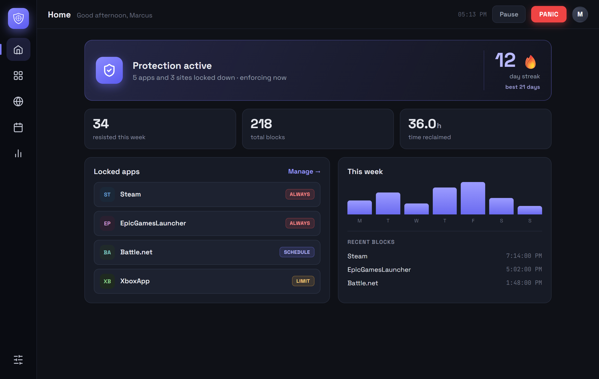
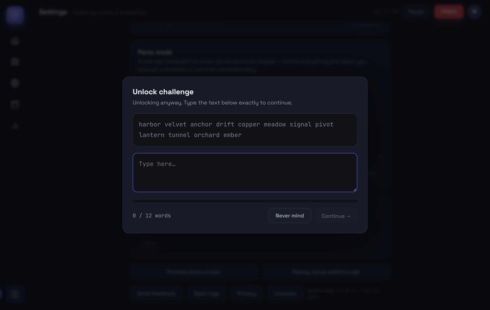
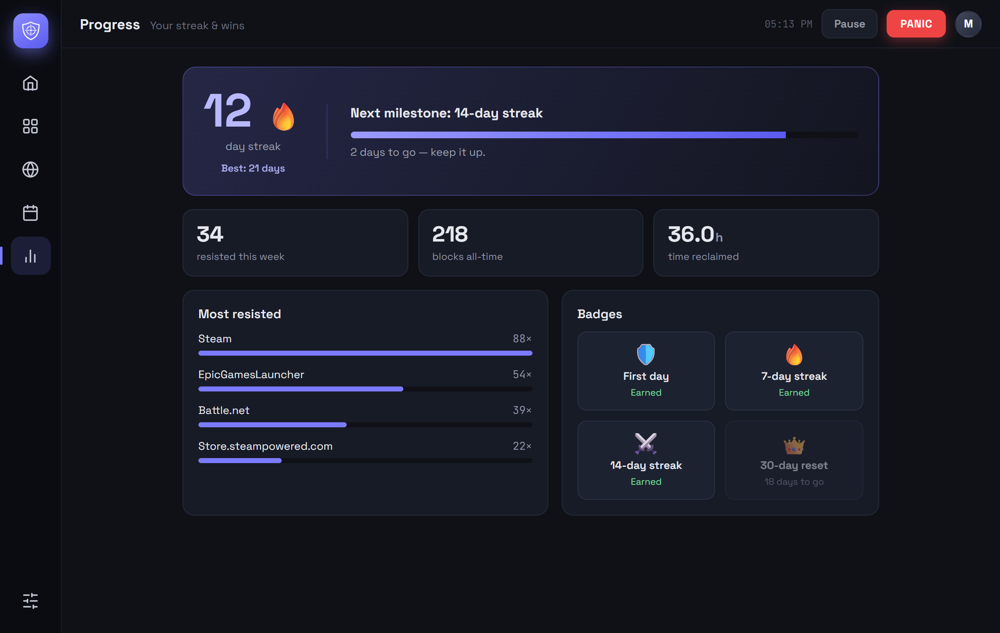
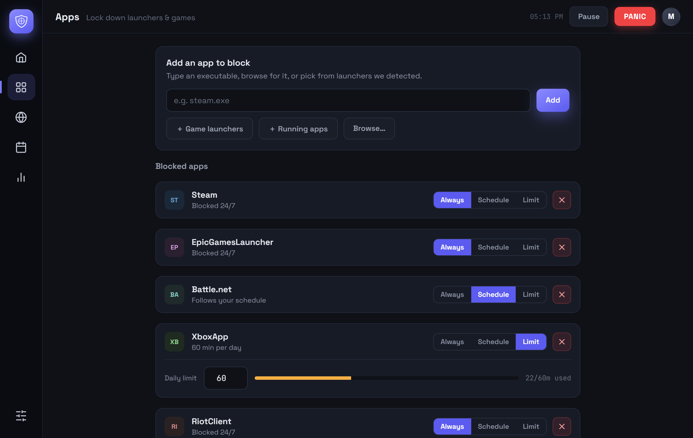
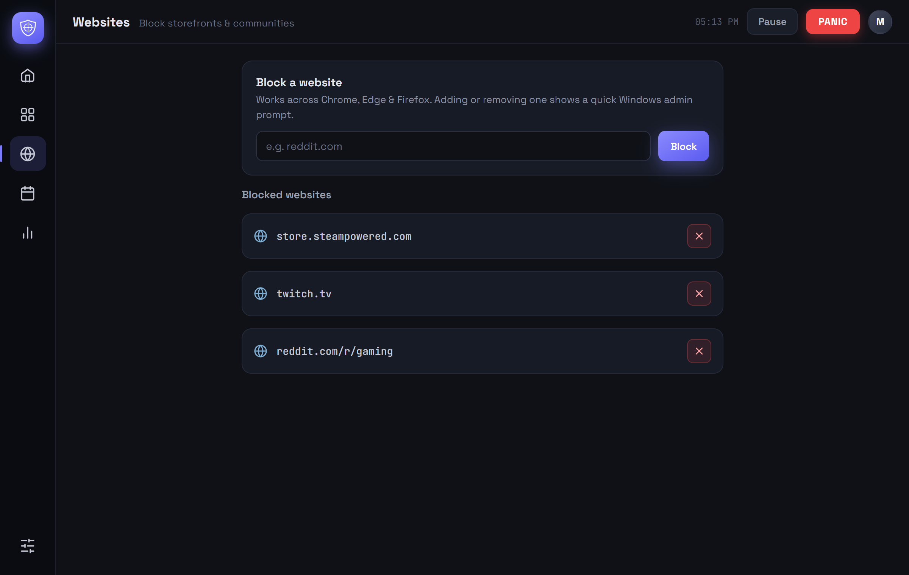
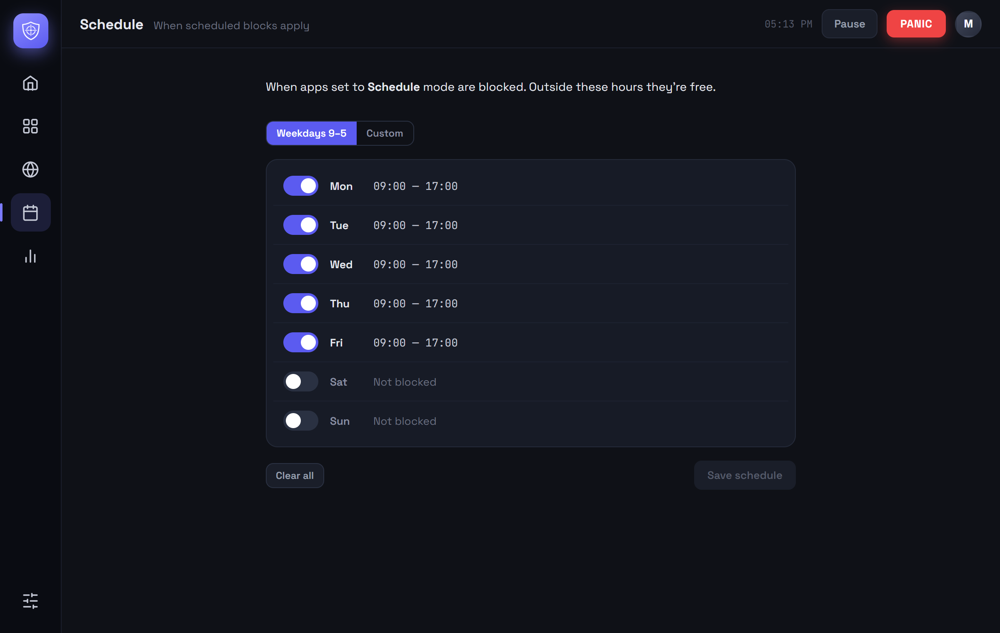
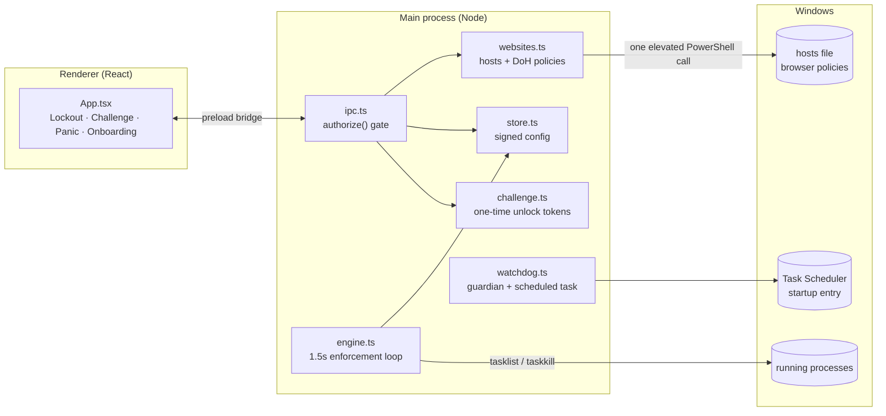

<p align="center">
  
</p>

<h1 align="center">Spawncamp</h1>

<p align="center">
  <strong>A Windows app and website blocker built for people quitting compulsive gaming.</strong><br />
  It closes blocked games the moment they open, blocks gaming sites at the system level,<br />
  and puts real friction between the urge and the relapse.
</p>

<p align="center">
  
  
  
  
  
  
</p>

<p align="center">
  
</p>

---

## Why it exists

Most blockers are built for productivity. They're easy to switch off, because
the person using them is assumed to be mostly in control. Compulsive gaming
doesn't work like that. The hard moment is a few seconds of impulse, often late
at night, and an "I'm sure, disable it" button gives way in exactly that moment.

Spawncamp is designed around that moment:

- **Blocking that holds.** Games and launchers are closed within about 1.5
  seconds of starting, and blocked websites are removed from DNS for the whole
  machine, not just for one browser.
- **Friction instead of a wall.** You *can* always get through. But the way out
  is a typing challenge that takes real time, and using it resets your streak.
  That leaves room for the urge to pass.
- **Honest about its limits.** It's your PC and you have admin rights, so a
  determined person can always beat software like this. Spawncamp makes the
  impulsive moment more costly and says so plainly. It doesn't claim to be
  unbeatable.

## How it works

```
 You open Steam
      │
      ▼
 Engine catches steam.exe ──► process closed ──► full-screen lockout
                                                     │
                       ┌─────────────────────────────┴─────────────────────────────┐
                       ▼                                                           ▼
           "I'm good — close this"                                       "Unlock anyway"
           (streak stays intact)                                                 │
                                                                                 ▼
                                                            Typing challenge (e.g. 140 random words)
                                                                                 │
                                                                                 ▼
                                                            15-minute pass for that one app,
                                                            and today's streak resets
```

<table>
  <tr>
    <td width="50%"></td>
    <td width="50%"></td>
  </tr>
  <tr>
    <td align="center"><sub>The lockout takes over the screen when a blocked app launches.</sub></td>
    <td align="center"><sub>Getting past it means typing a challenge out exactly. Pasting won't do it.</sub></td>
  </tr>
</table>

## Features

### Blocking

- **Apps, three ways.** Each blocked app is set to **Always**, **Schedule**
  (follows your weekly time windows), or **Limit** (a daily budget in minutes).
- **One-click launcher detection.** Finds installed Steam, Epic Games, Xbox,
  Battle.net, Riot / League of Legends, EA app, Ubisoft Connect, GOG Galaxy,
  Roblox, and Minecraft so you can block them during setup.
- **Folder blocks.** Block everything that runs from a folder (such as a whole
  Steam library), so launching a game's `.exe` directly doesn't get around the
  launcher block.
- **Website blocking.** Adds the sites you choose to the Windows `hosts` file
  and turns off DNS-over-HTTPS in Chrome, Edge, and Firefox, so the browsers
  can't route around the block. All of it happens in a single admin prompt.
- **Weekly schedule.** Set blocking windows for each day. An end time of 23:59
  covers the whole minute, so there's no free minute before midnight.

### Friction

- **Unlock challenge.** Protective actions need a challenge you configure:
  retype random words, random characters, or your own text, or wait out a
  timer. These include removing a block, weakening a schedule, pausing, and
  turning protection off.
- **Timed pause only.** Pausing is limited to 15 minutes, 1 hour, or until
  tomorrow. It needs the challenge, resumes automatically, and counts as a
  lapse. Website blocks stay on while paused.
- **Strict mode.** Settings stay locked even outside your scheduled hours, so a
  2 a.m. urge can't take apart tomorrow's blocks. Turning it off needs the
  challenge and only takes effect at midnight.
- **Panic button.** Starts a lockdown that can't be cancelled. It closes every
  blocked app (ignoring any active unlocks), can close your browsers, and shows
  a full-screen breathing countdown with your own mantra.
- **Daily commitment.** An optional morning screen where you retype your
  commitment for the day.

### Staying on

- **Stay-on protection.** A guardian process restarts Spawncamp if it's killed.
  A per-user scheduled task brings it back within a minute even after
  *End process tree* in Task Manager, and it starts with Windows.
- **Tamper-evident settings.** Settings files are signed with SHA-256. If one
  is edited outside the app, Spawncamp notices: the edit is kept (it's your
  machine), but today's streak resets and a notice explains why.
- **Locked-down production build.** DevTools and the default menu shortcuts are
  disabled in packaged builds, so the browser console isn't a back door.

### Progress

<table>
  <tr>
    <td width="50%"></td>
    <td width="50%"></td>
  </tr>
</table>

- Current and best **streak**, milestone progress, and **badges**.
- **Resisted this week**, total blocks, **time reclaimed**, and which apps you
  resisted most.

### Safety rails

A tool that closes processes has to be careful about which ones it closes.

- Core Windows processes (`explorer.exe`, `svchost.exe`, `winlogon.exe`, and
  others) can't be blocked, and the engine refuses to close them even if a rule
  matches.
- Folder blocks on drive roots, `C:\Windows`, the root of `Program Files`, or
  your user profile are refused.
- Spawncamp never closes itself.
- **Clean uninstall.** Uninstalling removes the hosts entries, the DNS-over-HTTPS
  policies, the scheduled task, and the startup entry. Your streak history is
  kept, so a reinstall picks up where you left off.

## Privacy

Everything stays on your PC. There are no accounts, no sign-in, no telemetry,
no analytics, and no crash reporting. The only network request is a check for
updates against GitHub Releases. See [PRIVACY.md](PRIVACY.md) for the full list
of what's stored and what's changed on your system.

## Screenshots

<table>
  <tr>
    <td width="50%"></td>
    <td width="50%"></td>
  </tr>
  <tr>
    <td align="center"><sub>Websites</sub></td>
    <td align="center"><sub>Schedule</sub></td>
  </tr>
</table>

<sub>Screenshots are from the renderer's browser preview with sample data.</sub>

## Architecture

Spawncamp is an Electron app. All enforcement runs in the **main process**,
and the React UI talks to it only through a typed preload bridge. Any action
that weakens protection is checked in the main process, so the UI can't
bypass it.



| Module | Responsibility |
| --- | --- |
| `index.ts` | App lifecycle: window and tray, single-instance lock, and three special launch modes (`--watchdog` guardian, `--from-task` silent restart, `--uninstall-cleanup`). |
| `engine.ts` | The 1.5-second enforcement loop: process polling, closing blocked apps, daily budgets, panic mode, and temporary unlocks. |
| `ipc.ts` | Every renderer-to-main call. Protective actions go through `authorize()`, which requires a challenge token while blocking is active (or always, in strict mode). |
| `challenge.ts` | Typing and timer challenges, which issue short-lived, single-use unlock tokens. |
| `store.ts` / `config-logic.ts` | Signed, tamper-evident config. The pure shape, default, and migration logic lives in `config-logic.ts`. |
| `schedule.ts` | Weekly time-window logic, with input sanitizing so a malformed schedule can't stop enforcement. |
| `websites.ts` / `hosts-logic.ts` | Hosts-file and DNS-over-HTTPS policy changes in one elevated PowerShell call, then a re-read of the hosts file to confirm the change actually applied. |
| `watchdog.ts` | Stay-on protection: a heartbeat guardian process and the per-user `SpawncampGuard` scheduled task. |
| `safety.ts` | Guardrails: the protected-process list, dangerous-folder checks, and `.exe` name normalization ("Steam" → `steam.exe`). |
| `stats.ts` / `streak.ts` | Block counts, lapse days, and streak math. The streak logic takes the current date as a parameter, so tests don't depend on the real clock. |
| `integrity.ts` | SHA-256 signing for tamper-evident files. |
| `updater.ts` | Auto-update through GitHub Releases. It stops protection cleanly before installing and turns it back on after. |

### Engineering notes

- **Checking real results, not exit codes.** When a UAC prompt is declined,
  the elevated PowerShell call can still exit with code 0. So after every
  hosts write, Spawncamp reads the hosts file back and confirms each domain is
  actually there before telling you a site is blocked.
- **The engine can't be bricked.** Schedule parsing never throws. Bad input
  turns blocking off for that schedule and logs it, while "Always" blocks keep
  working. A corrupted config can't silently turn off blocking.
- **Two independent layers of stay-on protection.** The guardian process covers
  the app being killed. The scheduled task covers the app and guardian being
  killed together with *End process tree*. Each layer handles a case the other
  can't.
- **Pure, testable core.** Hosts merging, schedules, streaks, challenges, config
  migration, signing, and the safety checks are all pure modules, covered by 51
  tests with `node:test` and no test framework.
- **CI on Windows.** Every push runs typecheck, lint, tests, and a build on
  `windows-latest`. Version tags also build the NSIS installer.

## Tech stack

**Electron 33** · **React 18** · **TypeScript 5** · **electron-vite** ·
**electron-builder** (NSIS installer) · **electron-updater** · `node:test` ·
ESLint + Prettier · GitHub Actions

## Getting started

Requires **Windows 10/11** and **Node.js 22+**.

```bash
npm install
npm run dev          # Electron with hot reload
npm run preview:web  # just the UI in a browser, with sample data
```

| Command | What it does |
| --- | --- |
| `npm run typecheck` | `tsc --noEmit` |
| `npm run lint` | ESLint |
| `npm test` | Unit tests (`node --test`, runs the TypeScript directly) |
| `npm run build` | Production build to `out/` |
| `npm run dist` | Full Windows installer to `dist/` |

> **Heads up:** a dev build really does close processes and can edit your
> hosts file (after a UAC prompt). Try it with something harmless like
> `notepad.exe` first.

## Project status

**Pre-release.** All correctness, safety, and enforcement work for v1.0 is
done. What's left before a public release is mostly about distribution:

- [x] Correctness and safety fixes from a full code audit
- [x] Enforcement integrity: gated pause, strict mode, tamper evidence, task re-arm
- [x] Clean uninstall, minimal installer contents, legal and privacy docs
- [x] Auto-update code, tests, linting, CI
- [ ] Code signing (Azure Trusted Signing)
- [ ] Public releases feed and an end-to-end update test
- [ ] Release QA on clean Windows 10 and 11 VMs

Planned after launch: an optional accountability partner, Steam library
auto-detection, challenges that get harder with each unlock in a day,
cooling-off periods for removals, and a browser extension for blocking at the
page level (for example, specific YouTube channels).

The detailed working plan, with every audit finding, design decision, and
verification note, is in [PRD.md](PRD.md).

## License

Copyright © 2026 Connor Drake. All rights reserved.

Spawncamp is proprietary software. The source code is shared here for
viewing only and is not licensed for reuse, modification, or redistribution.
See [LICENSE.md](LICENSE.md) and [THIRD-PARTY-NOTICES.md](THIRD-PARTY-NOTICES.md).
